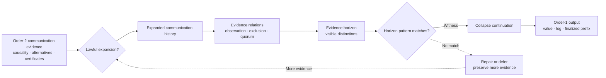
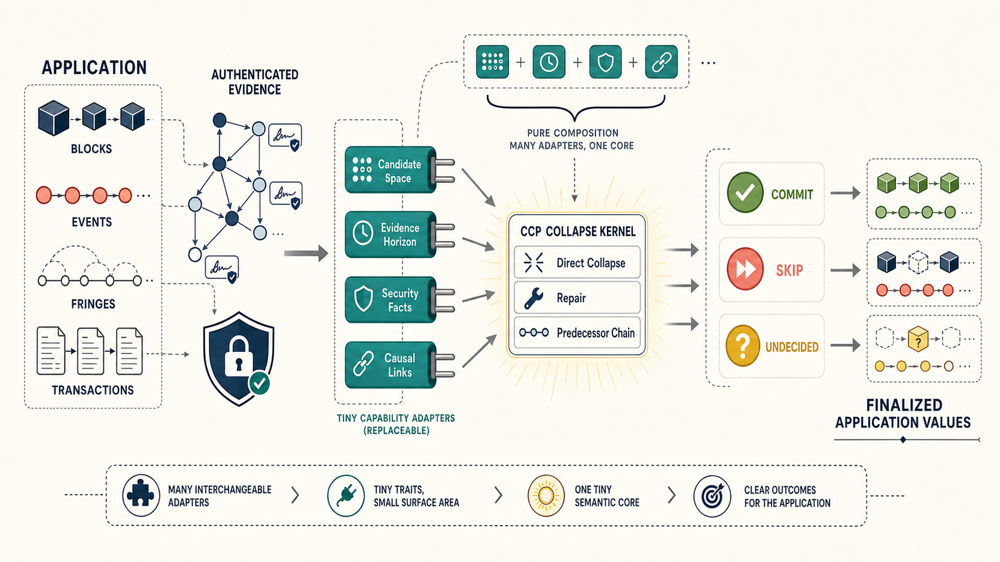

# CCP

[](https://crates.io/crates/consensus-ccp)
[](https://docs.rs/consensus-ccp)
[![Build and Test][ga-badge]][ga-url]
[](https://crates.io/crates/consensus-ccp)

[ga-badge]: https://github.com/tgrospic/consensus-ccp/actions/workflows/rust.yml/badge.svg?branch=master
[ga-url]: https://github.com/tgrospic/consensus-ccp/actions?query=branch:master

**Consensus as collapse under communication evidence.**

CCP is a denotational specification framework for comparing consensus protocols as collapse
policies. It starts with an explicitly chosen semantic carrier and asks which candidates a protocol
preserves, which evidence horizon it observes, when it projects that evidence into a decision or
finalized prefix, and how it repairs an inconclusive projection.

The framework currently interprets five policy families over shared semantic carriers:

- Mysticeti derives positive super-ratification and negative skip evidence from reachable messages,
  pipelines one leader per round, and repairs undecided slots through ordered later anchors.
- Cordial Miners uses the same positive approval, ratification, and super-ratification rule without
  pipelining or a negative skip certificate. It selects wave leaders, derives ratified predecessors,
  and emits approved, equivocation-excluding topological fragments.
- Adaptive uses pipelined round-robin leaders, a bounded adaptive horizon, >2/3 legitimacy, a
  latest-certified predecessor chain, and justification-history fringe projection.
- Dense leader keeps every candidate, lets one observer see >2/3 messages that see >2/3 of the prior round, uses no
  collapse bound, and finalizes every legitimate slot leader.
- Nakamoto retains valid proof-of-work forks, selects unique greatest cumulative work, projects a
  confirmation-depth prefix, and interprets its reversal risk separately.

CCP is a specification and comparison library. It does not provide networking, storage, validator
management, or a production consensus node.

For the examples in this repository, the communication evidence is also shown as a
round×validator message DAG with equivocations tracked separately from the canonical message
carrier.

The current round-advance knob is a fixed strict-supermajority policy: `>2/3` support over a one-round window.
Adaptive and Mysticeti both use a pipelined round-robin leader opportunity in every round. Adaptive
differs in its bounded reconstruction evidence and certified-predecessor repair, not in leader
cadence; a missing leader opportunity is skipped when a later finalized anchor crosses it.

The Byzantine protocol families share `EvidenceRelation`, `UncontestedRelation`, `QuorumOf`, and
an explicitly selected strict >2/3 threshold. Dense leader, Mysticeti, Adaptive, and Cordial give the resulting evidence
protocol-specific names and differ in leader selection, horizon, and repair—not in the positive
quorum algebra. Mysticeti skip support remains a distinct negative meaning.

The runtime retains immutable message-DAG histories behind a constructive machine boundary. Every
state change executes a typed input through `HistoryExpansion`; callers cannot insert facts, replace
history, author expansion edges, or assert collapse outcomes. The comparison runtime derives shared
evidence relations from the observer's causal past, then applies each protocol's horizon and leader
schedule.

## Semantic carrier

The carrier is semantic, not a simulation of packets or a fixed record format. A specification may
admit messages, authorship, validator identities, justification links, validated work, certificates,
or conclusions established by a lower semantic layer. Capability traits name those meanings and
laws state which interpretations are admissible.

Externality is therefore relative to the chosen boundary. Meaning supplied after the carrier is an
external dependency of that collapse. The same meaning can be internalized by enriching the carrier
and stating its laws. CCP does not prescribe one universal carrier; it makes the selected boundary
and every collapse dependency explicit.

```text
carrier + laws       = the semantic world
expansion policy     = the lawful future cone
extension bounds     = the meanings consumed by collapse
protocol extensions  = collapse in that world
```

## Protocol comparison

| Protocol | Candidate retention | Direct horizon | Collapse shape |
| --- | --- | --- | --- |
| Reference | every candidate | unbounded | semantic closure over the full carrier |
| Mysticeti | every candidate | fixed direct bound | direct commit/skip with ordered repair |
| Cordial | periodic leaders | fixed one-wave bound | final anchors and ratified predecessor chains |
| Adaptive | round-robin leader each round | bounded adaptive horizon | certified-anchor collapse, skips, and fringes |
| Dense leader | every candidate | unbounded | observer sees >2/3 messages that see >2/3 |
| Nakamoto | valid PoW forks | observed block tree plus depth `k` | greatest-work prefix; separate risk interpretation |

## Paper

The project accompanies **Consensus as Collapse Policy: Communication Evidence, Horizons, and
Prefix Decisions**. The paper is available on arXiv at
[`arXiv:2607.10152`](https://arxiv.org/abs/2607.10152).

The paper already places randomized asynchronous progress, probabilistic/common-prefix chain
security, and metastable sampling in the collapse-policy space. The Nakamoto exercise adds an
executable `PoW` instance of the same normal form: greatest-work fork choice and confirmation-depth
prefix projection, with a separate symbolic reversal-risk interpretation.

CCP factors the shared probabilistic shape into protocol-distinct confidence evidence and an
acceptance threshold. Nakamoto successor depth and repeated-sampling confidence can therefore use
the same composition and upward-closure law without becoming numerically interchangeable.

The central semantic distinction is:



Expansion determines which communication changes remain possible. Evidence relations derive what
messages observe, exclude, and support. A horizon pattern either returns a witness or does not
match. Only a witness enables the collapse continuation that turns retained order-2 evidence into
an order-1 result.

## Design

CCP calls its method **Design by Meaning**: a Rust adaptation of
[Conal Elliott's](http://conal.net/)
[Denotational Design](https://github.com/conal/talk-2014-bayhac-denotational-design). It starts by
giving domain types and operations implementation-independent meanings, derives operations
compositionally, and treats concrete Rust types as interpreters of that meaning. It is not merely a
preference for traits or dependency injection. See
[`DENOTATIONAL_DESIGN.md`](DENOTATIONAL_DESIGN.md) for the lineage, limits, and CCP mapping.

CCP follows specification-before-implementation. Specification crates live at the repository root;
concrete interpreters and runners live under `crates/`, following the ALUX workspace convention.

The compositional surface is:

- `CandidateSorts` names slots and candidates once; `CandidateSpace` and `SemanticClosure`
  inherit those names. `CollapseSorts` names the history, evidence, visible, and output carriers
  shared by the extraction, projection, and collapse capabilities.
- `HistoryExpansion` constructs lawful successor histories; `HistoryCollapse` observes reachable
  histories without changing them.
- `CandidateRestriction` and `EvidenceHorizon` state independent dimensions of information loss.
- `EvidenceExtraction`, `HorizonProjection`, and `CollapseRule` encode the paper's `D = C ∘ R ∘ L`
  normal form and its concrete-to-denotational realization law.
- `WitnessSelection` separates evidence scope from support and threshold. `QuorumOf` composes
  that scope with an `EvidenceRelation` and a `QuorumThreshold`.
- `CollapsePolicy<L, R, C>` composes independently supplied normal-form stages.
- `EvidenceRelation`, `QuorumOf`, `HorizonMatch`, and `MatchCollapse` expose the finer executable
  factorization used by Byzantine protocols.
- Extension methods derive reference and protocol-specific decisions from small capability sets.
- `ccp_runtime::Machine` owns one reachable history and delegates all changes to expansion.
- `ccp_runtime::CommunicationHistory` derives message-DAG evidence from validated message inputs.
- `FiniteExpansionExt` explores bounded futures by executing the same expansion capability; it does
  not accept authored histories, edges, or outcomes.
- Public law extensions check candidate, horizon, and decision refinement across interpreters.

Protocol specs depend directly on shared specs and carry their own laws. Their scenarios live in `ccp-scenarios`. The runtime
also imports these specs directly. `ccp` groups the specifications for applications; no spec
depends on it. Cross-protocol scenarios live in `ccp-comparison`.

The compact development context is part of the repository:

- [`ARCHITECTURE.md`](ARCHITECTURE.md) maps semantic layers and extension points.
- [`DENOTATIONAL_DESIGN.md`](DENOTATIONAL_DESIGN.md) defines design and review rules.
- [`assets/adaptive.md`](assets/adaptive.md) states adaptive collapse and fringe projection.
- [`assets/cordial.md`](assets/cordial.md) states Cordial Miners anchor collapse and blocklace ordering.
- [`assets/dense_leader.md`](assets/dense_leader.md) states the unbounded >2/3-legitimacy leader-finalization
  specification.
- [`assets/mysticeti.md`](assets/mysticeti.md) states Mysticeti-C direct decisions, indirect repair, and prefix
  closure.
- [`assets/nakamoto.md`](assets/nakamoto.md) separates greatest-work prefix collapse from risk interpretation.
- [`AGENTS.md`](AGENTS.md) gives coding agents and contributors the repository workflow and house
  conventions.
- [`crates/ccp-examples/src/policies.rs`](crates/ccp-examples/src/policies.rs) is an executable consumer
  example that prints a protocol comparison matrix.
- [`crates/ccp-examples/src/equivocations.rs`](crates/ccp-examples/src/equivocations.rs) contrasts the
  one-message-per-slot projection with the full carrier that retains conflicting messages.
- [`crates/ccp-examples/src/nakamoto.rs`](crates/ccp-examples/src/nakamoto.rs) demonstrates greatest-work
  fork choice, confirmation-depth prefix projection, and separate reversal-risk interpretation.

Run it with:

```sh
just example-policies
just example-equivocations
just example-nakamoto

# Runs every example.
just examples
```

## How CCP fits in



CCP is the small middle kernel, not the entire application runtime. An application still owns its
blocks, events, transactions, or fringes, along with storage and execution. It also chooses the
semantic boundary exposed to CCP. That carrier may include authenticated identities, validated
signatures, validator membership, quorum weights, proof of work, or any other explicitly named
meaning.

Small capability adapters interpret the chosen carrier for CCP: candidate space, evidence horizon,
security facts, causal links, and any conclusions admitted from a lower layer. CCP then composes
exactly those meanings according to a Mysticeti, Cordial Miners, Adaptive, Nakamoto, or reference
collapse policy and returns a protocol-appropriate decision in the application's own domain.

The boundary does not decree that security meaning is inside or outside consensus. It records the
choice. Different applications can enrich the carrier differently, while extension bounds and laws
make the resulting denotation comparable rather than implicit.

## Usage

Add the library to a Rust project:

```toml
[dependencies]
consensus-ccp = "0.1"
consensus-ccp-runtime = "0.1"
```

The package is named `consensus-ccp`; its Rust library name is `ccp`:

```rust
use ccp::communication::{MessageCarrierExt, MessageInput, MessageSlot, quorum_advance_policy};
use ccp_runtime::{CandidateId, CommunicationExpansion, CommunicationHistory, Machine, ValidatorId};

let history = CommunicationHistory::genesis((0..4).map(ValidatorId).collect())?;
let expansion = CommunicationExpansion::new(quorum_advance_policy());
let mut machine = Machine::new(history, expansion, ());
let message = MessageInput::new(MessageSlot::new(0, ValidatorId(0)), CandidateId(10), vec![]);

machine.apply(&message)?;
assert_eq!(machine.history().messages(), vec![CandidateId(10)]);
# Ok::<(), ccp_runtime::ExpansionError>(())
```

## Workspace

```text
.
|- ccp/                    grouping of the specifications (re-exports only)
|- ccp-core/               candidate/collapse sorts, expansion, restrictions, realization
|- ccp-validator/          validator committee, weight, and quorum threshold
|- ccp-quorum/             attributed evidence and weighted quorum composition
|- ccp-communication/      message carrier, admission, and communication evidence
|- ccp-leader/             leader scheduling and policy products
|- ccp-confidence/         confidence and acceptance
|- ccp-mysticeti/          Mysticeti specification and laws
|- ccp-cordial/            Cordial specification and laws
|- ccp-adaptive/           Adaptive specification and laws
|- ccp-dense-leader/       dense-leader specification and laws
|- ccp-nakamoto/           proof-of-work specification and laws
|- ccp-scenarios/          scenario-authoring language and protocol scenarios
|- ccp-comparison/         cross-protocol scenarios
|- crates/
|  |- ccp-runtime/         constructive carrier and machine interpreters
|  |- ccp-tests/           concrete conformance runners
|  `- ccp-examples/        executable protocol comparisons
|- .github/                build, lint, documentation, and test automation
|- ARCHITECTURE.md         semantic layers and extension points
|- DENOTATIONAL_DESIGN.md  design lineage, rules, and review criteria
|- AGENTS.md               compact repository context for coding agents
|- Cargo.toml              workspace metadata and shared dependencies
`- Justfile                local development commands
```

## TODO

The specifications are an initial design. Dense leader, Mysticeti, Cordial, and Nakamoto run end to end: each has a runtime interpreter, and the conformance runners execute its laws on every reachable scenario history. The reference closure and Adaptive are specified with capabilities and laws but have no interpreter yet.

### Specification coverage

- [ ] **Reference closure:** add a `SemanticClosure` interpreter so `check_decision_refinement` witnesses that closed protocol decisions refine unrestricted semantic closure.
- [ ] **Adaptive:** add a message interpreter for `CertifiedPredecessor` and `AdaptiveEvidence`, then run `check_adaptive_anchor_chain`, `check_adaptive_direct_legitimacy`, and `check_adaptive_prefix_compatibility`. The `policies` example currently collapses the Adaptive policy with the dense-leader `ScheduledLeaderCollapse`.
- [ ] **Invariant collapse:** reconcile `bounded_invariant_collapse` with paper Definition 2.6, which requires agreement among defined observations rather than one observation on every explored history.
- [ ] **Prefix observation:** make the observation boundary explicit so the prefix-extension laws and the paper's equality criterion can be identified.

### Packaging

- [ ] **Published crates:** publish only `consensus-ccp` and `consensus-ccp-runtime`. `ccp` re-exports separate spec crates, and crates.io requires every dependency of a published crate to be published, so the specs must either become modules of `ccp` or be published too.

### Validator integration

- [ ] **Stake-weighted runs:** give the runtime carrier a weighted genesis committee so scenarios exercise non-unit weights; reference interpretations currently assign unit weight.
- [ ] **Epochs:** model one committee per epoch and the handover between epochs.
- [ ] **Evidence feedback:** derive validator performance from CCP evidence and offenses from equivocation evidence, for validator-management systems such as `alux-stake` that implement `ccp-validator`. Decide where that bridge lives.

### Deeper protocol coverage

The paper also gives semantic readings of Paxos, Raft, PBFT, HotStuff, Tendermint, CBC Casper, HoneyBadger, Snowman/Avalanche, DAG-Rider, and other protocols.

The next implementations should maximize semantic variety rather than add several protocols with
nearly identical quorum machinery:

- [ ] **Paxos:** capture ballot order, promises, quorum intersection, chosen-value invariance, and
  higher-ballot repair.
- [ ] **CBC Casper:** capture justified-message carriers, estimators, equivocation-bounded admissible
  futures, and safety-oracle closure.
- [ ] **HoneyBadger:** separate deterministic agreement safety from probabilistic asynchronous
  progress through reliable broadcast, binary agreement, and common-coin repair.
- [ ] **Snowman:** interpret repeated sampling and protocol-specific confidence through the shared
  confidence-to-acceptance algebra without equating samples with Nakamoto confirmations.

Each protocol addition must state its complete normal form:

```text
carrier H
    -> evidence extraction L
    -> horizon R
    -> pattern match
    -> collapse C
    -> output P
    -> repair or deferral
```

It must also add the smallest required capabilities, reusable laws, and a concrete scenario. The
goal is to show that the common semantic grammar captures different evidence algebras without
normalizing proof of work, quorum certificates, ratification, and sampling confidence into one
untyped score.

## Development

The workspace requires Rust 1.97.

```sh
just build
just test
just clippy
just doc
just ci
```

`just test` uses `cargo-nextest` for library and integration tests and runs documentation tests
separately.

See [`CONTRIBUTING.md`](CONTRIBUTING.md) before submitting changes.

## License

CCP is available under the MIT License.
